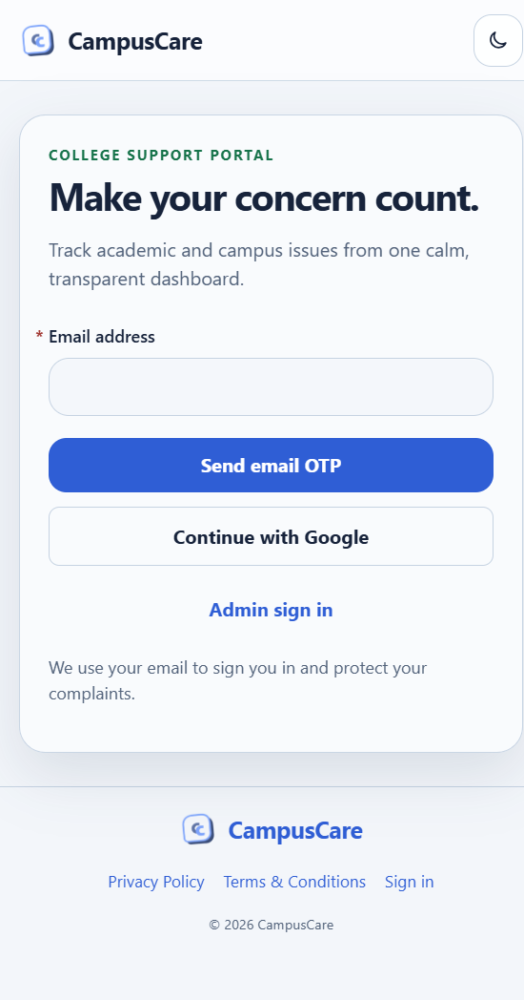
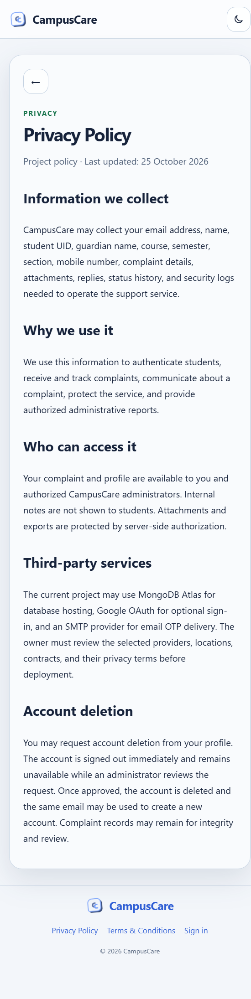

# CampusCare

CampusCare is a full-stack college complaint portal for students and authorized administrators. Students can sign in with email OTP or Google, complete their profile, submit verified complaints, upload limited PDF/JPEG evidence, track status history, and request account deletion. Administrators can review complaints, update statuses, manage student accounts, review deletion requests, and export authorized reports.

## Preview





## Highlights

- Email OTP and optional Google OAuth sign-in
- Required first-time student profile setup
- Student dashboard and separate complaints list
- Complaint submission with email verification OTP
- PDF/JPEG attachment validation and 1 MB limit
- Student complaint history, replies, statuses, and audit timeline
- Admin complaint console and student account management
- CSV, Excel, and PDF export endpoints
- In-app notification center with unread counts
- Account deletion request and administrator review workflow
- Responsive mobile navigation and light/dark themes
- Accessible custom category and subcategory listboxes
- Privacy Policy, Terms and Conditions, favicon, metadata, and custom 404 page
- HttpOnly authentication cookie, server-side authorization, rate limiting, hashed OTPs, and security headers

## Project structure

```text
.
├── client/              React and Vite frontend
├── server/              Express, MongoDB, authentication, and API
├── docs/                README screenshots
├── uploads/             Local attachment storage, ignored by Git
├── .env.example         Environment variable template
└── package.json         Root development and validation scripts
```

## Requirements

- Node.js 20 or newer
- npm
- MongoDB Atlas or another MongoDB deployment
- SMTP credentials for real email OTP delivery
- Google OAuth credentials if Google sign-in is enabled

## Run locally

```powershell
cd campuscare
npm install
npm --prefix client install
Copy-Item .env.example .env
```

Edit `.env` and set at least:

```env
PORT=4000
CLIENT_URL=http://localhost:5173
PUBLIC_URL=http://localhost:5173
MONGODB_URI=mongodb+srv://<user>:<password>@<cluster>/college_complaints?retryWrites=true&w=majority
JWT_SECRET=<long-random-secret>
OTP_SECRET=<different-long-random-secret>
COOKIE_SECURE=false
```

Start the API and Vite development server:

```powershell
npm run dev
```

- Frontend: `http://localhost:5173`
- API: `http://localhost:4000`
- Health check: `http://localhost:4000/api/health`

The development Vite server proxies `/api` to port 4000. In development only, empty SMTP settings use a JSON mail transport and print the development message in the API terminal. Use real SMTP credentials before sharing or deploying the application.

## Authentication configuration

### Email OTP

```env
SMTP_HOST=smtp.example.com
SMTP_PORT=587
SMTP_USER=your-smtp-username
SMTP_PASS=your-smtp-password
MAIL_FROM=no-reply@example.com
```

OTP codes are stored as keyed hashes, expire quickly, are single-use, and are rate-limited. Never commit SMTP credentials.

### Google OAuth

For local development, add this redirect URI to the Google OAuth client:

```text
http://localhost:4000/api/auth/google/callback
```

Then set:

```env
GOOGLE_CLIENT_ID=your-client-id
GOOGLE_CLIENT_SECRET=your-client-secret
GOOGLE_CALLBACK_URL=http://localhost:4000/api/auth/google/callback
```

The callback URL must exactly match the URL configured in Google Cloud Console, including scheme, host, port, path, and trailing slash behavior.

## Production build and preview

Build the optimized frontend:

```powershell
npm run build
```

Preview the production frontend locally:

```powershell
npm run preview
```

The production preview runs on `http://localhost:4173`. Unlike the development server, it does not proxy the API. For a separate frontend deployment, set `VITE_API_URL` before building:

```powershell
$env:VITE_API_URL="https://api.example.com/api"
npm run build
```

## Deployment guide

The application is easiest to deploy as two services:

1. An Express API service running `server/index.js`
2. A static Vite frontend built from `client/`

MongoDB Atlas can host the database. Use the provider's current free or paid offering according to its terms; availability and limits can change.

### Deploy the API

On a Node-compatible host such as Render, Railway, Fly.io, or a VPS:

- Repository root: project root
- Build command: `npm install`
- Start command: `npm start`
- Health check: `/api/health`

Set these server environment variables:

```env
NODE_ENV=production
PORT=4000
CLIENT_URL=https://your-frontend.example
PUBLIC_URL=https://your-frontend.example
MONGODB_URI=...
JWT_SECRET=...
OTP_SECRET=...
COOKIE_SECURE=true
SMTP_HOST=...
SMTP_PORT=587
SMTP_USER=...
SMTP_PASS=...
MAIL_FROM=...
GOOGLE_CLIENT_ID=...
GOOGLE_CLIENT_SECRET=...
GOOGLE_CALLBACK_URL=https://your-api.example.com/api/auth/google/callback
ADMIN_EMAIL=...
ADMIN_PASSWORD_HASH=...
```

Use a platform secret manager for credentials. Do not place production values in GitHub, the README, build logs, or screenshots.

### Deploy the frontend

On a static host such as Vercel, Netlify, Cloudflare Pages, or Render Static Sites:

- Project root: project root
- Build command: `npm run build`
- Publish directory: `client/dist`

Set this build-time environment variable:

```env
VITE_API_URL=https://your-api.example.com/api
```

Rebuild after changing it. Configure the static host to fall back unknown routes to `client/index.html` so React Router pages work on refresh.

### Finish Google OAuth setup

After both services have stable HTTPS URLs, add this exact URL to Google Cloud Console:

```text
https://your-api.example.com/api/auth/google/callback
```

Set the same value as `GOOGLE_CALLBACK_URL`. Add the frontend origin to the OAuth client's authorized JavaScript origins if the provider requests it.

### Production checklist

- Use HTTPS for both frontend and API.
- Set `COOKIE_SECURE=true`.
- Use strong, different `JWT_SECRET` and `OTP_SECRET` values.
- Restrict MongoDB Atlas network access to the deployment service where possible.
- Configure SMTP and verify delivery before enabling sign-in.
- Rotate any credentials that were ever exposed during development.
- Set a backup and retention policy for MongoDB and uploaded files.
- Review the privacy policy, terms, data location, retention, and institutional approval.
- Run `npm test`, `npm run build`, and `npm audit --omit=dev`.

## Validation

```powershell
npm test
npm run build
node --check server/index.js
node --check server/models.js
```

## Security notes

The server enforces role-based authorization for complaints, attachments, messages, exports, notifications, and administrator actions. Uploads are restricted by extension, MIME type, file signature, and size. OTPs are hashed and rate-limited. Authentication uses HttpOnly cookies and the server sends security headers.

The legal pages are project templates, not legal advice or a compliance certification. Review them with the institution and applicable counsel before production use.

## License

No license has been selected yet. Add a license file before accepting external contributions or redistributing the project.
